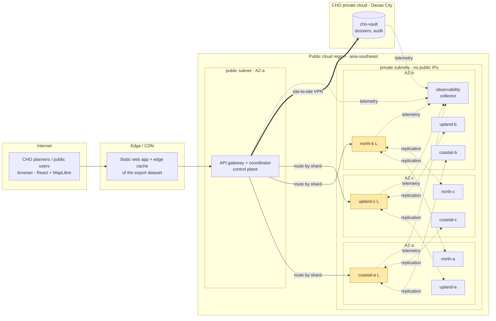
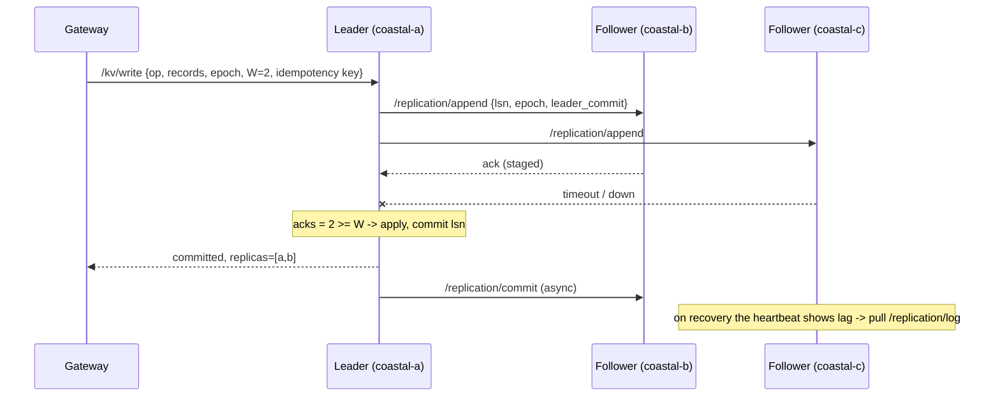
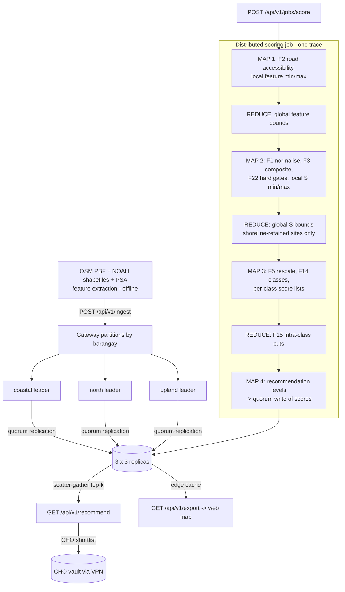

# POLARIS Cloud — Distributed Architecture Design

**Base system:** POLARIS (Priority-Optimized Location and Risk-Adaptive Infrastructure Siting), from the thesis
*"A GIS-Based Decision Support Framework for Optimum Health Facility Site Selection with Hazard Risk
Sensitivity Analysis"*. University of the Immaculate Conception, College of Computer Studies.

**Course:** CS012 Final Project. Redesign of the thesis system as a cloud-based distributed system.
**Author:** Carl Stephen Sanguenza

---

## 0. From thesis prototype to distributed system

| Thesis prototype (today) | POLARIS Cloud (this design) |
|---|---|
| A single Google Colab notebook computes every score in one process | Three geographic shards compute their own sites in parallel. Only summary statistics move between nodes. |
| `candidate_sites.json` is a static file on Vercel | A replicated site store. The JSON is served through an edge cache and rebuilt after every write. |
| No writes after export | Hazard re-classifications (for example, new Project NOAH advisories) are written with a quorum and re-gated straight away. Re-scoring runs as a distributed job. |
| CHO shortlists and expert checklists are kept on paper or on local files | A CHO private-cloud vault, reached only through a site-to-site VPN |
| Errors appear only in the notebook output | Structured events, distributed traces and per-node metrics on every node |

The scoring model has not changed. Every node uses `common/scoring.py`, a pure-Python port of the
thesis formula register (F1, F2, F3, F5, F14, F15, F22). Scenario 2 of the simulation checks the
distributed result against the notebook's baseline score S′ for all 1,502 sites. The largest difference
is |Δ| = 1.7 × 10⁻¹⁶. The run gates 275 sites (18.3 %), which matches the thesis figure.

> **Scope note.** In the thesis, the published score is the Random Forest surrogate's prediction
> (R² = 0.96 against S′). The simulation scores sites with the deterministic S′, which is the RF's
> training target. For that reason it reports 40 Highly Suitable sites rather than the RF's 37. In the
> cloud design, RF training is an offline batch component. It reads a consistent snapshot of the shards
> (see §4.2) and is not simulated.

---

## 1. Network topology



**Topology type.** The design is *hierarchical*. A **star** control plane sits on top: the gateway is the hub
and probes every node. Under it, each shard is a small **full mesh**: the leader replicates to both
followers, and any follower can pull catch-up entries from the leader. Nothing talks directly across
shards, so the number of cross-shard links stays constant as the cluster grows.

| Link | Simulated one-way latency | Real-world equivalent |
|---|---|---|
| same AZ | 1 ms | intra-AZ VPC traffic |
| cross AZ | 4 ms | inter-AZ traffic in one region |
| public region ↔ CHO | 30 ms | IPsec site-to-site VPN over the internet |

`common/net.py` injects these latencies on every hop, using the zone table in `common/topology.py`.

**Segmentation.** Only the gateway sits in a public subnet. Data nodes and the collector sit in private
subnets and have no public endpoints. The vault sits in a separate network (`cho-vpc`) that only the VPN
tunnel reaches.

**Placement decisions**

* Each shard keeps one replica in each AZ. Losing a whole AZ therefore costs every shard one replica,
  and a quorum of 2 out of 3 survives.
* The three shard leaders start in three different AZs: coastal→a, north→b, upland→c. One AZ outage
  takes out at most one leader.
* Eventual reads go to followers first, to take load off the leader. Among followers, the lowest-latency
  link wins: an AZ-a follower is chosen for the AZ-a gateway.

---

## 2. CAP theorem

Network partitions will happen (P), so the real choice is **C or A for each kind of data and each
operation**. POLARIS does not make one global choice:

| Data / operation | Choice | Mechanism | Why |
|---|---|---|---|
| Site writes (ingest, hazard updates, published scores) | **CP** | W = 2 of N = 3. The leader commits only on quorum. The gateway rejects a write early when fewer than W replicas are alive. | A lost or diverging hazard update could leave a site eligible when it should be gated. That is a safety problem. |
| `consistency=strong` reads | **CP** | R = 2 quorum read. The highest version wins, and stale replicas are fixed by read repair. W + R > N. | Used for official CHO decisions: shortlists, dossiers, audits. |
| `consistency=eventual` reads, map export | **AP** | Any one live replica answers. The response reports the replication lag. | Browsing the public map is better slightly stale than offline. |
| District scoring job | **CP** | Needs every shard leader. If one is missing, the job aborts. | Global min-max normalisation over a partial dataset would quietly shift every score. |
| Leader election | **CP** | A leader is elected only by a live majority. A minority shard becomes read-only. Epochs fence old leaders. | Prevents split brain. |
| CHO vault | **CP** (single node) | Fails closed and never falls back to the public cloud. | Data Privacy Act (RA 10173). Data sovereignty matters more than uptime. |
| Telemetry | **AP** | Fire-and-forget batches. Buffers with drop-oldest. The local JSONL is the source of truth. | Observability must never block or break the data path. |

Under PACELC, when there is no partition (the *Else* case), the system trades latency for consistency
on writes (it waits for a second replica, about 20 ms here). On eventual reads it chooses latency.

**Shown in the simulation:**
* Scenario 5: during an asymmetric partition, an *eventual* read returns a site as **eligible** after it was
  re-classified to High flood. A *strong* read returns the correct, gated record and repairs the stale replica.
* Scenario 6: with 2 of 3 replicas gone, writes and strong reads return 503 (CP). Eventual reads and the
  district query still answer (AP).
* Scenario 9: with a whole shard gone, the district query returns a degraded partial answer that names the
  missing barangays. The scoring job refuses to run.

---

## 3. Sharding and replication

### 3.1 Sharding: directory-based, geographic

Most GIS queries are spatial. Planners ask about barangays and areas, not random keys. Hash sharding
would spread every barangay across all nodes, so the shard key is the **barangay**. Barangays are
grouped into three spatially contiguous shards of similar size:

| Shard | Barangays | Sites |
|---|---|---|
| `coastal` | Bago Aplaya, Bucana, Matina Aplaya, Talomo, Dumoy, Matina Crossing, Catalunan Pequeño | 534 |
| `north` | Ma-a, Langub, Magtuod, Matina Pangi | 525 |
| `upland` | Catalunan Grande, Bago Gallera, Baliok | 443 |

* **Directory.** The gateway holds `barangay → shard` and `site_id → shard`. When a `site_id` is not in
  the directory, the gateway broadcasts a lookup and caches the answer. In production, the directory
  lives in the replicated config store.
* **Query routing.** A barangay query touches one shard. A district query is a **scatter-gather**: each
  shard returns its local top-k and the gateway does a k-way merge.
* **Rebalancing.** To rebalance, move one barangay to another shard: copy its data, then flip one
  directory entry. Hashing would remap many keys at once.
* **Bonus.** All storm-surge-exposed coastal sites sit together on one shard, so hazard updates from a
  coastal advisory touch only one replica group.

### 3.2 Replication: single leader, quorum commit, epochs



* **Log sequence numbers (LSN).** Each entry has a version (`_v`) and every record keeps it, which lets
  quorum reads tell which copy is newer.
* **Staging → commit.** A follower stages an entry and applies it only when the leader's commit index covers it.
  If quorum fails, the leader throws the entry away, so no replica ever applies an uncommitted write.
* **Gap repair.** A follower that missed entries answers `need_from`, and the leader ships the missing
  committed suffix (`REPLICATION_BACKFILL`).
* **Anti-entropy.** Every heartbeat carries the leader's LSN. A follower that is behind pulls the log, or
  takes a full snapshot if its log diverged (`CATCHUP_COMPLETE` / `SNAPSHOT_RESYNC`).
* **Election.** When the leader is DOWN, the gateway promotes the live replica with the highest log
  position, but only if a majority is alive, and bumps the **epoch**. A healed old leader sees the higher
  epoch and steps down (`LEADER_STEP_DOWN`). Any append carrying an old epoch is rejected with 409
  (`FENCED_STALE_LEADER`).
* **Idempotency keys.** Each write carries a key, so the leader can deduplicate retries.

---

## 4. Cloud components and cloud deployment model

### 4.1 Deployment model: **hybrid cloud**

* **Public cloud:** elastic compute and storage for the analytic workload and the public map. This data is
  non-sensitive: open data from OSM, Project NOAH and PSA aggregates.
* **Private cloud:** the CHO's own infrastructure, or a government cloud, holds data that must stay under
  LGU control. This covers planner shortlists, notes, Tier-4 expert checklists and UAT sign-offs.
* **Connectivity:** a site-to-site IPsec VPN that ends at the gateway. The vault also checks for itself
  that each request came through the tunnel (zero trust), so it does not rely on the gateway alone.

### 4.2 Components (with a reference mapping to managed services)

| Simulated component | Responsibility | Service model | AWS / GCP reference |
|---|---|---|---|
| `coordinator/` gateway | TLS termination, auth (role + key), routing, quorum logic, scatter-gather, job orchestration | PaaS | API Gateway + ECS/Fargate · Cloud Endpoints + Cloud Run |
| Gateway control plane | Membership, failure detector, leader election, shard directory | PaaS | etcd on EKS, or a managed consensus store |
| `node/` data/compute nodes ×9 | Shard storage and replication. Runs the shard-local scoring steps next to the data. | IaaS / containers | EC2 or EKS pods with EBS, across 3 AZs · GKE + PD |
| Edge cache | Caches the export dataset, keyed by data version | SaaS | CloudFront · Cloud CDN |
| Static web app | React + MapLibre front end (already on Vercel) | SaaS | Vercel / S3 + CloudFront |
| `collector/` | Event and trace ingestion, trace reconstruction, event counts | PaaS | OpenTelemetry Collector → X-Ray / CloudWatch · Cloud Trace / Logging |
| `vault/` | Confidential CHO records, append-only audit trail | Private cloud | On-prem VM / GovCloud PH |
| VPN tunnel | Encrypted public↔private link | IaaS | AWS Site-to-Site VPN · Cloud VPN |
| Batch training (not simulated) | Trains the RF surrogate from a strong export snapshot | PaaS | SageMaker / Vertex AI training job |
| Secrets (not simulated) | CHO API keys, TLS certificates | SaaS | Secrets Manager · Secret Manager |

**Scaling path.** Add shards by splitting barangay groups. Raise N to 5 for larger districts. The gateway
is stateless apart from the directory, so it scales horizontally once the directory moves to the config
store. Several districts of Davao City would be several sets of shards behind the same gateway tier.

---

## 5. Observability, tracing and system resilience

### 5.1 Observability: three signals from every process

| Signal | How | Where to see it |
|---|---|---|
| **Events** | `telemetry.event(NAME, **attrs)` on every meaningful action. A full run produces about 290 events of 56 types. | Node console, `logs/<node>.jsonl`, `logs/collector_all.jsonl`, `GET collector/events` |
| **Traces** | Middleware creates a span per request. `X-Trace-ID`, `X-Parent-Span-ID` and `X-Source-Node` travel on every hop. | `GET collector/traces/{id}` (span tree) · `python -m tools.trace_view <id>` |
| **Metrics** | Count, errors and p50/p95/p99 per route on every node. Circuit-breaker states and replication lag in `/cluster/status`. | `GET /metrics` per node · `GET gateway/cluster/metrics` |

Health checks and heartbeats are not traced, which is a common sampling rule. Background work such as
failure detection, election and catch-up runs on `sys-*` traces, and the simulation prints those as a
control-plane timeline.

Excerpt of a real trace (Scenario 5, strong read with read repair):

```
|- [    0.0ms +   16.9ms] gateway    GET /api/v1/sites/TALOMO_0464  (200)
  |- [    2.7ms +    0.4ms] coastal-a  GET /kv/site/TALOMO_0464  (200)
  |- [    6.9ms +    0.4ms] coastal-b  GET /kv/site/TALOMO_0464  (200)
  |- [    7.2ms +    0.5ms] coastal-c  GET /kv/site/TALOMO_0464  (200)
   .     8.9ms INFO  QUORUM_READ versions={"coastal-a": 4, "coastal-b": 2, "coastal-c": 4} chosen=coastal-a
   .     9.1ms WARN  READ_REPAIR_SENT replica=coastal-b to_version=4
  |- [   14.7ms +    1.0ms] coastal-b  POST /replication/repair  (200)
     .    15.5ms WARN  READ_REPAIR_APPLIED old_version=2 new_version=4
```

### 5.2 Resilience patterns

| Pattern | Implementation | Scenario |
|---|---|---|
| Replication + quorum | N = 3, W = 2, R = 2 | 1, 4 |
| Failure detection | Heartbeat every 0.5 s. One miss → SUSPECT, two → DOWN. Back → RECOVERED. | 4, 6, 7, 9 |
| Leader failover | Majority-only election, epochs, fencing | 7 |
| Catch-up / anti-entropy | Log pull, backfill, snapshot resync | 4, 5, 7 |
| Read repair | Strong reads push the newest version to stale replicas | 5 |
| Time-outs + retries | Per-call time-outs. Retries with exponential back-off and jitter on idempotent calls. | all |
| Circuit breaker | Per destination: CLOSED → OPEN after 3 failures → HALF_OPEN after 3 s → CLOSED | 8 |
| Replica failover | An eventual read moves to the next replica when one fails | 8 |
| Graceful degradation | Partial scatter-gather results, flagged `degraded`, listing the missing barangays | 9 |
| Fail closed | The vault never falls back to public storage | 10 |
| Job restart | The scoring job waits for failover and restarts once, then aborts | 9 |
| Chaos engineering | `POST /admin/chaos/{node}`: `crash`, `partition`, `peer_partition`, `slow`, `flaky` | 4–10 |

---

## 6. End-to-end data flow



Only summary statistics cross the network during the job: bounds, sorted class scores and cut points.
Site rows never leave their shard until they are published.

---

## 7. Event catalogue (selection)

| Event | Emitted by | Meaning |
|---|---|---|
| `NODE_JOINED` / `NODE_SUSPECT` / `NODE_DOWN` / `NODE_RECOVERED` | gateway | Failure-detector state changes |
| `LEADER_ELECTED` / `LEADER_PROMOTED` / `LEADER_STEP_DOWN` / `SHARD_READ_ONLY` | gateway / node | Election, promotion, fencing, refusal to elect without a majority |
| `INGEST_PARTITIONED` / `SHARD_ROUTED` | gateway | Sharding decisions |
| `REPLICATION_SENT` / `REPLICA_APPEND_STAGED` / `WRITE_COMMITTED` / `WRITE_REJECTED` | node | Replication protocol |
| `QUORUM_PRECHECK_FAILED` / `STRONG_READ_REJECTED` | gateway | CP refusals |
| `STALE_READ_POSSIBLE` / `QUORUM_READ` / `READ_REPAIR_SENT` / `READ_REPAIR_APPLIED` | gateway / node | Consistency checks |
| `CATCHUP_COMPLETE` / `REPLICATION_BACKFILL` / `SNAPSHOT_RESYNC` | node | Anti-entropy |
| `JOB_STARTED` / `JOB_PHASE_*` / `GLOBAL_REDUCE` / `FEATURE_EXTRACTION_COMPLETE` / `COMPOSITE_SCORED` / `CLASSIFIED` / `SCORES_PUBLISHED` / `JOB_COMPLETED` | gateway / node | Distributed scoring |
| `QUERY_PLANNED` / `LOCAL_TOPK` / `SCATTER_GATHER_MERGED` / `DEGRADED_RESPONSE` | gateway / node | Query execution |
| `EDGE_CACHE_HIT` / `EDGE_CACHE_MISS` | gateway | CDN behaviour |
| `VPN_TUNNEL_FORWARD` / `AUTHZ_DENIED` / `VPC_ACCESS_DENIED` / `DOSSIER_STORED` / `PRIVATE_CLOUD_UNAVAILABLE` | gateway / vault | Hybrid-cloud security path |
| `RETRY` / `CALL_FAILED` / `CIRCUIT_OPEN` / `CIRCUIT_HALF_OPEN` / `CIRCUIT_CLOSED` / `REPLICA_FAILOVER` | any | Resilience mechanics |
| `CHAOS_INJECTED` / `CHAOS_HEALED` / `NODE_RESTARTED` | any | Fault injection |

---

## 8. Known simplifications

* All 13 "nodes" are processes on one machine. Latency and failures are injected, not real.
* The gateway's control-plane state lives in memory, so the gateway is a single point of failure in the
  simulation. The design puts that state in a Raft-replicated store (etcd) behind ≥ 2 gateway instances.
* Storage is in memory. A crash keeps the store and committed log, acting as durable disk, and drops
  volatile state such as staged entries, job scratch and idempotency cache.
* The replication protocol is Raft-like but not full Raft. Election is decided by the control plane, not by
  a vote among the replicas. A staged-but-uncommitted entry on a newly promoted leader is committed on
  promotion.
* Authentication is a demo role and key header. Production would use OIDC (for example, the LGU's identity
  provider) and mTLS between services.
